

  <picture>
    <source media="(prefers-color-scheme: light)" srcset="assets/generated/hero-light.svg" />
    
  </picture>

  <h1>🌸 Gorrawit Puttabarramee  / Amp</h1>
  
<b>B.Sc. Computer Science Student</b> Aspiring Software Developer &amp; Cybersecurity Enthusiast

  

  

    <a href="#about">About</a> &nbsp; / &nbsp;
    <a href="#stack">Tech Stack</a> &nbsp; / &nbsp;
    <a href="#projects">Projects</a> &nbsp; / &nbsp;
    <a href="#activity">GitHub Pulse</a> &nbsp; / &nbsp;
    <a href="#credentials">Resume &amp; Certificates</a> &nbsp; / &nbsp;
    <a href="#connect">Connect</a>
  

## 🌸 01 &nbsp; / &nbsp; A little about me

I'm a 3rd-year Computer Science student at **Huachiew Chalermprakiet University**. I am a cooperative and friendly team player who is passionate about coding, system design, and exploring network security. Having secured an internship, I'm looking forward to applying my foundational skills to real-world challenges, contributing to a team, and learning from experienced professionals.

When I'm taking a break from the screen, I'm usually hitting the bars for some **Calisthenics** or just relaxing with some **games**.

`Coding` &nbsp; `System Design` &nbsp; `Network Security` &nbsp; `Calisthenics` &nbsp; `Gaming`

 

## 🌸 02 &nbsp; / &nbsp; The tools behind the ideas

**Programming languages**

  
  
  
  
  

**Web, frameworks & databases**

  
  
  
  
  
  

**Tools & platforms**

  
  
  
  
  

**Hardware & computer vision**

  
  
  
  

**Networking & security**

  
  

## 🌸 03 &nbsp; / &nbsp; Ideas, turned into projects

### 🛡️ Anti-Drone System

**TESA TOP GUN RALLY 2025** &nbsp; · &nbsp; `YOLOv8` `MATLAB` `React` `GPS Telemetry`

- Developed a real-time detection system using **YOLOv8** to calculate precise GPS coordinates for threat localization.
- Engineered **MATLAB** autonomous flight algorithms to neutralize targets.
- Built a **React** dashboard displaying live GPS telemetry.

---

### 🇨🇳 Shanghai Solo Trip Guide

`HTML5` `CSS3` `Vanilla JavaScript` `Leaflet.js`

- A comprehensive tourism guide website for Thai solo travelers visiting Shanghai.
- Built with **HTML5**, **CSS3**, and **Vanilla JavaScript** featuring 30+ attractions with real photos.
- Includes interactive **Leaflet.js** map, budget/style filters, zone-based recommendations, and CNY-THB converter.

---

### 🚗 Parking Management System

`Java Swing` `PHP` `BCrypt` `Role-based Dashboards`

- Full Stack Developer for a comprehensive parking solution.
- Developed a hybrid platform integrating **Java Swing** and **PHP** with **BCrypt** security.
- Designed role-based dashboards for real-time monitoring.

---

### 🖥️ AR Computer Components Explorer

`Unity` `Augmented Reality` `Interactive 3D`

- Developed an educational Augmented Reality (AR) application using **Unity** to visualize computer hardware.
- Created interactive 3D models for users to study essential internal components such as CPUs, GPUs, RAM, and Mainboards.

## 🌸 04 &nbsp; / &nbsp; GitHub pulse

<a href="https://github.com/Ampsoria?tab=repositories">
  <picture>
    <source media="(max-width: 600px)" srcset="assets/generated/github-stats-mobile.svg" />
    
  </picture>
</a>

  
<b>Explore my language landscape &amp; recent projects</b>

   
  <picture>
    <source media="(max-width: 600px)" srcset="assets/generated/github-activity-mobile.svg" />
    
  </picture>
  
Public GitHub data. Language counts use each repository's primary language; forks are excluded. Recently pushed projects exclude this profile repository.

## 🌸 05 &nbsp; / &nbsp; Beyond the code

### 📄 Resume

Want to know more about my academic background and experiences?

**📂 Download my full resume:**

### 🏆 Certificates & Activities

Explore my verified achievements, training, and extra-curricular activities:

**📜 View my Gallery:**

## 🌸 06 &nbsp; / &nbsp; Let's connect!

   
  
  
  
  
  
ampsoriainyourarea@gmail.com LINE: amp2648 &nbsp; · &nbsp; (+66) 65-498-6129

   
  <a href="#top">↑ Back to top</a>

